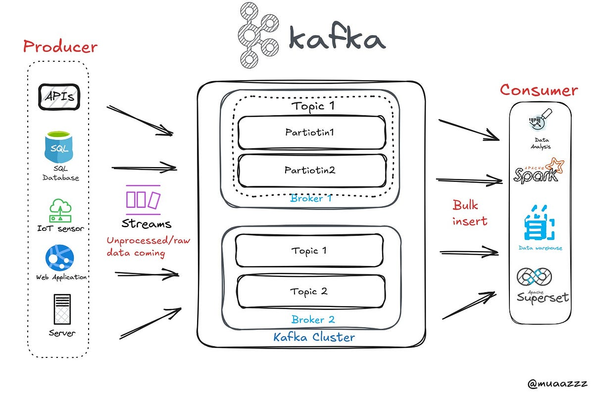

Table of contents

1. [What is kafka ?](#what-is-kafka)

## what-is-kafka
Apache Kafka is an open-source, distributed event streaming platform used to publish, store, and process streams of real-time data at high scale. Originally created at LinkedIn, it decouples data producers from data consumers so systems can exchange events asynchronously and reliably.

